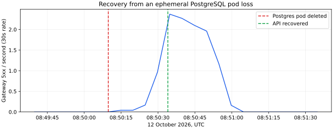

# Lab 9 — Stateful Services & DB Reliability

Tested on 12 October 2026 in the existing `quickticket` k3d cluster. All times below are UTC. The unchanged application and Rollout manifests are carried forward from Lab 7 so ArgoCD can manage the complete application.

## Task 1 — Migration and backup/restore

The restarted, ephemeral database was initialized with `app/seed.sql`. Two mixedload pods exercised `/events`, `/reserve`, and `/pay`. A separate event with 100,000 tickets prevented inventory exhaustion during the experiment; it and its orders were removed afterwards.

### Migration under load

[Alembic configuration](../alembic.ini) and [migrations](../migrations/) use a no-op baseline for the existing seed schema, followed by the nullable `events.email` migration. I stamped `0001`, then ran `alembic upgrade head` while both load pods were running.

`alembic history`:

```text
0001 -> 0002 (head), Add an optional contact email to events.
<base> -> 0001, baseline existing schema
```

Elapsed time, measured around the Alembic process with a monotonic timer: **0.360 seconds**.

| Measurement | Before, 08:47:42 | After, 08:48:49 |
|---|---:|---:|
| Gateway 5xx in the previous minute | 0 | 0 |
| Orders | 358 | 722 |

Query: `sum(increase(gateway_requests_total{status=~"5.."}[1m])) or vector(0)`.

`psql ... -c '\d events'`:

```text
Table "public.events"
    Column     |           Type           | Collation | Nullable |              Default
---------------+--------------------------+-----------+----------+------------------------------------
 id            | integer                  |           | not null | nextval('events_id_seq'::regclass)
 name          | text                     |           | not null |
 venue         | text                     |           | not null |
 event_date    | timestamp with time zone |           | not null |
 total_tickets | integer                  |           | not null |
 price_cents   | integer                  |           | not null |
 email         | character varying(255)   |           |          |
Indexes:
    "events_pkey" PRIMARY KEY, btree (id)
Referenced by:
    TABLE "orders" CONSTRAINT "orders_event_id_fkey" FOREIGN KEY (event_id) REFERENCES events(id)
```

No extra 5xx were observed. Adding a nullable column without a default avoids rewriting existing rows, but `ALTER TABLE` still acquires an exclusive lock. The migration uses a five-second lock timeout rather than waiting indefinitely. See [PostgreSQL ALTER TABLE](https://www.postgresql.org/docs/17/sql-altertable.html).

### Backup and DROP TABLE recovery

I paused load only for this count comparison and created a custom-format archive with `pg_dump -U quickticket -Fc quickticket`. The archive was streamed as binary data, without a TTY.

`ls -lh` and `file`:

```text
-rw-rw-r-- 1 nikitakhripunkov nikitakhripunkov 38K Oct 12 11:49 .lab9-local/quickticket.dump
.lab9-local/quickticket.dump: PostgreSQL custom database dump - v1.16-0
```

`pg_restore --list` excerpt:

```text
;
; Archive created at 2026-10-12 08:49:23 UTC
;     dbname: quickticket
;     TOC Entries: 18
;     Compression: gzip
;     Dump Version: 1.16-0
;     Format: CUSTOM
;     Integer: 4 bytes
;     Offset: 8 bytes
;     Dumped from database version: 17.9
;     Dumped by pg_dump version: 17.9
;
;
; Selected TOC Entries:
;
220; 1259 16411 TABLE public alembic_version quickticket
218; 1259 16389 TABLE public events quickticket
217; 1259 16388 SEQUENCE public events_id_seq quickticket
3444; 0 0 SEQUENCE OWNED BY public events_id_seq quickticket
219; 1259 16397 TABLE public orders quickticket
3279; 2604 16392 DEFAULT public events id quickticket
3437; 0 16411 TABLE DATA public alembic_version quickticket
3435; 0 16389 TABLE DATA public events quickticket
3436; 0 16397 TABLE DATA public orders quickticket
3445; 0 0 SEQUENCE SET public events_id_seq quickticket
```

| State | Events | Orders | GET /events |
|---|---:|---:|---:|
| Before DROP, snapshot at 08:49:22 | 6 | 886 | 200 |
| After `DROP TABLE orders CASCADE` | 6 | table absent | 502 |
| After `pg_restore --clean --if-exists --exit-on-error` | 6 | 886 | 200 |

A single dump has no fixed RPO: the possible loss grows with its age. Scheduled dumps reduce the interval; WAL archiving with point-in-time recovery would reduce it further. Backups also need an off-node copy to survive loss of the local cluster.

## Task 2 — Disaster recovery under load

Both load pods kept running during the forced deletion of the ephemeral Postgres pod and recovery from the earlier dump.

| Phase | UTC |
|---|---|
| Disaster started | 08:50:09.776 |
| Replacement pod Ready | 08:50:12.255 |
| Database restored | 08:50:23.313 |
| Events restarted; API verified 200 | 08:50:34.000 |

**RTO: 24.22 seconds**, from the recorded disaster timestamp to the completed successful API check. Kubernetes Ready initially preceded SQL readiness because the old deployment had no database readiness probe.

The replacement database had no application tables and `/events` returned 502. Its data had lived in the deleted container's writable layer. After restoring the dump, I restarted the events service to replace stale database connections.

- Orders before disaster: **1090**.
- Orders immediately after restore: **886**.
- Lost pre-disaster order IDs: **204**.
- Recovery-point age: **47.33 seconds**, from backup start at 08:49:22.443 to the disaster. Requests remained active, so these counts describe the sampled boundary rather than every in-flight write.



The curve uses `sum(rate(gateway_requests_total{status=~"5.."}[30s])) or vector(0)`, sampled every five seconds. The trailing window explains why the curve decays after recovery. The next complete minute contained zero 5xx.

## Bonus — Persistent storage and scheduled backups

### PVC and repeated recovery test

I backed up the live database before moving it onto the fresh PVC, restored it there, and checked matching row counts. `PGDATA` uses a subdirectory; `Recreate` avoids two database processes sharing the volume. A readiness probe checks PostgreSQL.

Diff against the Lab 7 Postgres manifest:

```diff
--- Lab 7/k8s/postgres.yaml
+++ k8s/postgres.yaml
@@ -1,2 +1,13 @@
+apiVersion: v1
+kind: PersistentVolumeClaim
+metadata:
+  name: postgres-data
+spec:
+  accessModes:
+  - ReadWriteOnce
+  resources:
+    requests:
+      storage: 1Gi
+---
 apiVersion: apps/v1
 kind: Deployment
@@ -26,4 +37,6 @@
         - name: POSTGRES_PASSWORD
           value: quickticket
+        - name: PGDATA
+          value: /var/lib/postgresql/data/pgdata
         resources:
           requests:
@@ -33,4 +46,23 @@
             cpu: 200m
             memory: 256Mi
+        volumeMounts:
+        - name: data
+          mountPath: /var/lib/postgresql/data
+        readinessProbe:
+          exec:
+            command:
+            - pg_isready
+            - -U
+            - quickticket
+            - -d
+            - quickticket
+          initialDelaySeconds: 2
+          periodSeconds: 2
+      volumes:
+      - name: data
+        persistentVolumeClaim:
+          claimName: postgres-data
+  strategy:
+    type: Recreate
 ---
 apiVersion: v1
```

Repeated pod deletion under the same two-pod mixedload:

| Phase | UTC |
|---|---|
| Disaster started | 08:56:32.436 |
| Replacement pod Ready | 08:56:37.598 |
| Existing data verified; no restore required | 08:56:38.972 |
| Events reconnected; API verified 200 | 08:56:55.577 |

**PVC RTO: 23.14 seconds**, compared with 24.22 seconds without PVC. All **2405** sampled pre-disaster order IDs survived (**0 lost**). The events service was restarted in both tests. The measured improvement is only about one second: this tiny archive restores quickly, and reconnecting the application dominates both measurements. The main improvement is zero lost data and no restore step. This PVC protects against pod replacement, not deletion of the local node or volume.

### Backup CronJob and retention

[`k8s/backup-cronjob.yaml`](../k8s/backup-cronjob.yaml):

```yaml
apiVersion: batch/v1
kind: CronJob
metadata:
  name: postgres-backup
spec:
  schedule: '*/5 * * * *'
  timeZone: Etc/UTC
  concurrencyPolicy: Forbid
  successfulJobsHistoryLimit: 3
  failedJobsHistoryLimit: 3
  jobTemplate:
    spec:
      backoffLimit: 2
      template:
        spec:
          restartPolicy: OnFailure
          containers:
            - name: backup
              image: postgres:17-alpine
              env:
                - {name: PGHOST, value: postgres}
                - {name: PGUSER, value: quickticket}
                - {name: PGDATABASE, value: quickticket}
                - {name: PGPASSWORD, value: quickticket}
              command:
                - sh
                - -ec
                - |
                  cd /backups
                  file="quickticket_$(date -u +%Y%m%dT%H%M%SZ).dump"
                  tmp="$file.tmp"
                  trap 'rm -f "$tmp"' EXIT
                  pg_dump -Fc -f "$tmp"
                  pg_restore --list "$tmp" > /dev/null
                  mv "$tmp" "$file"
                  echo "Created $file"
                  ls -1t quickticket_*.dump | tail -n +6 | xargs -r rm -v
              volumeMounts:
                - {name: backups, mountPath: /backups}
          volumes:
            - name: backups
              persistentVolumeClaim:
                claimName: postgres-backups
```

The job uses the separate `postgres-backups` PVC. It validates each archive's TOC before publishing its final filename and rotating older dumps. I suspended scheduled execution during seven sequential manual jobs, then re-enabled it.

Seventh job log:

```text
Created quickticket_20261012T085801Z.dump
removed 'quickticket_20261012T085742Z.dump'
```

`ls -la /backups` after all seven jobs — exactly five archives:

```text
total 48
drwxrwxrwx    2 root     root          4096 Oct 12 08:58 .
drwxr-xr-x    1 root     root          4096 Oct 12 08:57 ..
-rw-r--r--    1 root     root          5408 Oct 12 08:57 quickticket_20261012T085746Z.dump
-rw-r--r--    1 root     root          5408 Oct 12 08:57 quickticket_20261012T085750Z.dump
-rw-r--r--    1 root     root          5408 Oct 12 08:57 quickticket_20261012T085754Z.dump
-rw-r--r--    1 root     root          5408 Oct 12 08:57 quickticket_20261012T085757Z.dump
-rw-r--r--    1 root     root          5408 Oct 12 08:58 quickticket_20261012T085801Z.dump
```

All seven jobs completed successfully. Five-minute scheduling gives a nominal recovery-point interval of five minutes plus backup duration, provided jobs succeed; missed or failed jobs increase the gap.

## Final state

The synthetic event and its orders, mixedload, seven manual jobs, and temporary backup inspector were removed. The application has five seed events and zero orders; `email` and Alembic revision `0002` remain. Postgres and backup PVCs and the five-minute CronJob are retained for Lab 10. Both volumes are local to this single-node cluster. ArgoCD manages `feature/lab9` with self-healing enabled.
