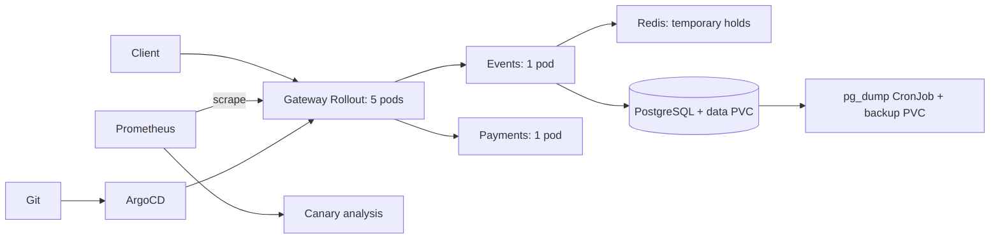

# QuickTicket SRE Handbook

Operational snapshot: 12 October 2026. Use the `k3d-quickticket` context. The application namespace is `default`; monitoring is in `monitoring` and GitOps is in `argocd`.

## Architecture



- One k3d node; Services route internal traffic. Locust must run inside the cluster.
- PostgreSQL and backups have separate local 1 GiB PVCs. Neither survives loss of the node's storage.
- Reservations expire in Redis; confirmed orders live in PostgreSQL. The current Locust scenario does not pay for reservations.

## How to deploy

The fork is `nikitadev-work/SRE-Intro`. CI watches **fork `main`**, but ArgoCD now watches **`feature/lab9`, path `k8s`**. This requires an explicit promotion step:

1. Commit application changes to fork `main` and record that application commit SHA. Push and wait for the `CI` workflow to succeed. It builds three GHCR images tagged with that SHA and commits image updates to `main`.
2. In `feature/lab9`, update only the `image` fields of `k8s/gateway.yaml`, `events.yaml`, and `payments.yaml` to those SHA-tagged images. Keep the Rollout, PVC, and backup configuration. Commit and push this promotion; copying all manifests from `main` would discard later lab changes.
3. ArgoCD polls and synchronizes automatically. Verify:

```bash
kubectl -n argocd get application quickticket
kubectl argo rollouts get rollout gateway
kubectl get analysisrun
```

The gateway gates at 20% using canary-only `/events` errors, then advances through 60% to 100%. Generate event-read traffic during analysis: no samples must not pass as healthy. The gate is below 5% errors, which is looser than the 0.5% availability budget. Confirm five ready replicas and a successful API request after promotion. `ghcr-secret` must retain package read access.

For a bad canary, run `kubectl argo rollouts abort gateway`, then revert the promotion commit in `feature/lab9` and push. Abort changes live traffic; the Git revert makes the fix durable under self-healing.

## Monitoring

Open in-cluster Prometheus:

```bash
kubectl -n monitoring port-forward svc/prometheus 19091:9090
```

At `http://localhost:19091`, check:

```promql
# Request rate and availability errors, excluding process probes
sum(rate(gateway_requests_total{path!="/openapi.json"}[5m]))
(sum(rate(gateway_requests_total{path!="/openapi.json",status=~"5.."}[5m])) or vector(0))
/ sum(rate(gateway_requests_total{path!="/openapi.json"}[5m]))

# Latency by endpoint
histogram_quantile(0.99, sum by (le,path)(rate(gateway_request_duration_seconds_bucket[5m])))
```

Check CPU with `kubectl top pods`; inspect endpoints, readiness and logs when traffic drops. The payment p99 warning (>1s for 30s) is installed. Notification delivery from this Prometheus has not been configured. The older Lab 6 Grafana dashboard/alerts belong to a separate Compose environment.

## Incident response

1. Record UTC start time and affected endpoints. Check `kubectl get pods`, `/health`, request errors and endpoint latency; a healthy process does not prove checkout works.
2. Inspect recent gateway/events/payments logs and the last Git change. For Redis failure, Events readiness may also remove the read endpoint. For a database restart, inspect tables before considering recovery; do not blindly re-seed a populated database.
3. Restore the last known-good configuration through Git. Verify fault settings are zero and `DB_MAX_CONNS=10`. Restart Events only if database connections remain stale after the dependency recovers.
4. Verify browsing and a reserve-and-pay request, then watch the rolling error/latency window return to normal. Record impact and follow-up work.

If unresolved after 10 minutes, contact the course instructor/TA through Moodle with timestamps, request failures, logs and attempted fixes. Do not send credentials.

## Backup and restore

The `postgres-backup` CronJob runs every five minutes and retains five archives. Check `kubectl get cronjob,jobs,pvc`; inspect the latest Job logs for successful creation and rotation. A missed backup increases the recovery-point gap. For an extra backup:

```bash
kubectl create job --from=cronjob/postgres-backup backup-$(date -u +%Y%m%d%H%M%S)
```

For a restore, first stop client/test writes during maintenance and take a safety dump. Mount the backup PVC using the supplied inspector:

```bash
kubectl apply -f labs/lab9/backup-storage.yaml
kubectl rollout status deployment/backup-inspector
kubectl exec deployment/backup-inspector -- ls -lt /backups
```

Choose a known-good archive from that list and assign its filename to `DUMP`. The following replaces database objects; check the selected recovery point before running it:

```bash
set -o pipefail
kubectl exec deployment/backup-inspector -- cat "/backups/$DUMP" |
  kubectl exec -i deployment/postgres -- pg_restore -U quickticket -d quickticket --clean --if-exists --exit-on-error
kubectl rollout restart deployment/events
kubectl rollout status deployment/events
kubectl exec deployment/postgres -- psql -U quickticket -d quickticket -c 'SELECT count(*) FROM events; SELECT count(*) FROM orders;'
kubectl delete deployment backup-inspector
```

Verify API 200 and expected counts before resuming traffic. Reconcile temporary Redis holds with the restored database; in this isolated lab, clear them with `redis-cli FLUSHDB`. Pod replacement on the data PVC should not require a dump restore. [Lab 9](https://github.com/inno-devops-labs/SRE-Intro/pull/638) records the tested recovery and retention procedure.
